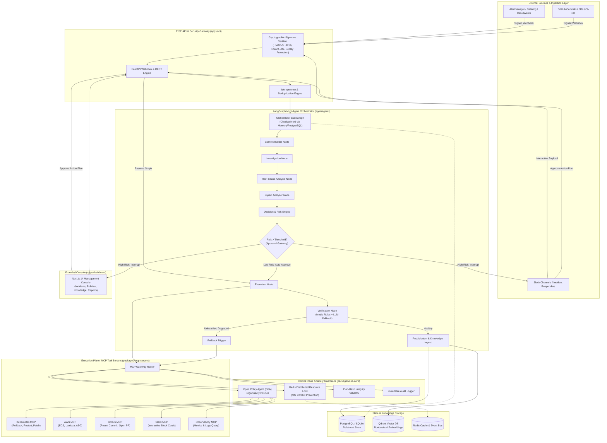
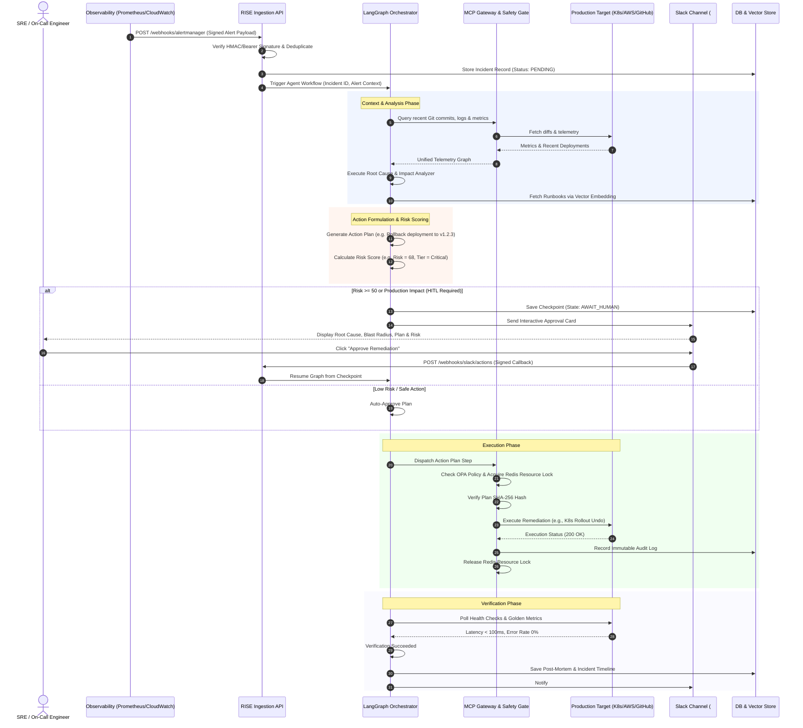

# RISE (Reliability & Incident Self-Healing Engine)
## Architecture, Data Flow, Implementation Status & Operational Audit

---

> **⚠️ Current Implementation Status vs. Target Architecture — status note added 2026-09-29.**
> This document mixes **target-state architecture** with **current implementation status**. Several "✅ implemented" lines below, and both Mermaid diagrams (§3, §4), describe the *intended* design rather than what the code does today. Where a diagram edge or an "implemented" line is contradicted here, **this note is the accurate description.**
>
> - **Canonical name.** Per `README.md` and `CLAUDE.md` the engine is **"Resilient Incident & Remediation System Engine."** The title on line 1 ("Reliability & Incident Self-Healing Engine") is an older variant, not the canonical name.
> - **Ingestion does not auto-run the graph.** `stream:events` (Redis Streams) is **producer-only** — no consumer subscribes. Auto-running the orchestrator on ingestion is gated by `AUTO_RUN_AGENT_GRAPH` (default **off**; disabled under test/CI). The graph runs as an invoked library, not an alert-triggered pipeline. The `DEDUP --> ORCH` / `Trigger Agent Workflow` edges are target state.
> - **MCP servers are in-process, not isolated (ADR-001).** The four real servers (kubernetes, aws, github, slack) are imported via `sys.path.insert`, not run as isolated processes.
> - **Two MCP servers are not implemented.** `mcp-observability` and `mcp-knowledge` are **README-only stub directories**; the gateway allow-lists their tool names but **raises a not-implemented error** if dispatched. The `MCP_OBS` node and every "Observability/Knowledge MCP" implemented claim are target state. (A separate in-process Qdrant knowledge *service* at `packages/rise-core/knowledge_service/` does exist — it is not an MCP server.)
> - **The gateway is a static Python allow-list, not OPA (ADR-002).** `evaluate_python_allowlist` is a hardcoded allow-list (defense-in-depth). **Real OPA/Rego runs upstream in the Risk Engine**, not "before any MCP tool execution." The `MCP_GW --> OPA --> MCP_*` edges (§3) and the execution-time "Check OPA Policy" step (§4) are target state.
> - **The real PR path commits templated patches, not a grounded/validated LLM diff (ADR-004).** Real PRs are written by `github_service.commit_remediation_to_github`, which fetches the real file bytes then calls `apply_patch_to_text` — a **keyword/filename-matched, hardcoded** transform (with a comment-prepending fallback). **No LLM and no patch-validator run on this path.** The grounded + validated LLM diff exists only in the agent-graph path, which is not auto-triggered and routes to the `mcp-github` **simulation** fixture. Bridging them is tracked as **P0-1 (pending)**.
> - **Security actions and post-remediation metrics are simulated.** Security responses (`block_ip_address`, `isolate_host`, `revoke_session_token`, …) are audited **no-ops**, and the verifier's `post_action_metrics` (`health_status: "200 OK"`, `error_rate: 0.0`) are **hardcoded sentinels** in `approve_action`, not fetched live. The §4 "Poll Health Checks & Golden Metrics → Error Rate 0%" step is synthetic.
> - **Runtime footprint.** Celery runs a **single** beat task (`check_approval_sla_timeout_task`), not the LangGraph workers. The `apps/agents` container is **liveness-only** (compiles the graph as a fail-loud check; serves `/healthz`); it does **not** accept incident traffic.
> - **LLM providers.** Only **Gemini, OpenAI, Ollama, Groq** adapters exist (`llm_gateway/providers.py`). "Anthropic" / "Claude" / "Bedrock" references below are **not** implemented.
> - **Test count unverified.** The "560+ tests" figure (§2.1) is **not** independently verified in this pass.

---

## 1. Executive Summary

**RISE** is an enterprise-grade, autonomous incident remediation and self-healing engine. It ingests alerts and change events from observability platforms (Prometheus, Alertmanager, Datadog, AWS CloudWatch), reconstructs incident context across git repositories and telemetry, performs automated root-cause analysis (RCA) and blast-radius impact analysis via LangGraph multi-agent orchestration, synthesizes safety-verified action plans, and executes remediations via in-process Model Context Protocol (MCP) tool servers (ADR-001) under human-in-the-loop (HITL) approval, with policy enforced upstream in the Risk Engine (OPA/Rego) plus a static allow-list at the MCP gateway (ADR-002). *(Out-of-process "isolated" MCP and execution-time OPA are target state — see the status note above.)*

---

## 2. Implementation Status: What is Working vs. What is Pending

### ✅ 2.1 Implemented (Working) — *see the status note near the top for items below that are target-state or not-yet-implemented*

1. **Multi-Agent Orchestrator Graph (`apps/agents/src/orchestrator/graph.py`)**:
   - Built on **LangGraph** `StateGraph` with state checkpointing (`MemorySaver` / `PostgresSaver`).
   - Durable pause/resume mechanics across process restarts via `interrupt_after=["await_human"]`.
   - Node progression: **Context Builder** $\to$ **Investigation** $\to$ **Root Cause** $\to$ **Impact Analyzer** $\to$ **Decision / Action Planner** $\to$ **Approval Gate (HITL)** $\to$ **Execution** $\to$ **Verification** $\to$ **Post-Mortem / Rollback**.

2. **Multi-Agent Nodes & Decision Engines (`apps/agents/src/nodes/` & `engines/`)**:
   - **Context Builder**: Correlates alerts, Git commits, PR diffs, Slack threads, and CMDB service topologies.
   - **Investigation Node**: Forms ranked root-cause hypotheses from the gathered context via the LLM gateway. *(There is no observability MCP server today — log/metric enrichment via MCP is target state; see the status note above.)*
   - **Root Cause Engine**: Hypothesis formulation against recent deployments, code changes, and infrastructure anomalies.
   - **Impact Analyzer**: Computes blast radius, affected downstream services, tenant tiers, and SLO breaches.
   - **Action Planner & Risk Engine**: Generates targeted remediation steps (Kubernetes pod restart, deployment rollback, config patch, autoscaling, GitHub PR revert), calculating risk score (0–100) and confidence score (0–1.0).
   - **Verification Node**: Hybrid rule-based health/metric evaluation with LLM fallback verdict; triggers rollback on failure. *(On the current `approve_action` path the post-action metrics are hardcoded sentinels, not fetched live — see the status note above.)*

3. **Security & Guardrail Middleware (`packages/rise-core/mcp_client/`)**:
   - **Policy Gate**: The MCP gateway enforces a **static Python allow-list** (`evaluate_python_allowlist`) that blocks non-allow-listed tools and unsafe arguments (defense-in-depth). **Real OPA/Rego evaluation (`policies/guardrails/rego/safety.rego`) runs upstream in the Risk Engine**, not at MCP dispatch time (ADR-002).
   - **Resource Concurrency Lock Manager (`lock.py`)**: Distributed Redis locking with in-memory fallback to prevent race conditions or simultaneous mutating actions on the same infrastructure resource (returns HTTP 409 `RESOURCE_LOCKED`).
   - **Plan-Hash Integrity Check**: SHA-256 hash validation before execution to ensure no tampered steps execute without re-authorization (returns HTTP 409 `ACTION_PLAN_CHANGED`).
   - **Immutable Audit Logging**: Every tool dispatch records input parameters, user ID, tenant ID, and approval metadata.

4. **Webhook Ingestion & Cryptographic Verifiers (`apps/api/src/routers/webhooks.py`)**:
   - **GitHub Webhooks**: HMAC-SHA256 signature verification (`X-Hub-Signature-256`).
   - **Alertmanager / Prometheus**: Shared-secret bearer header verification.
   - **AWS CloudWatch / SNS**: Cryptographic X.509 certificate signature verification.
   - **Slack Interactive Callbacks**: HMAC-SHA256 signature + timestamp replay protection.
   - **Idempotency**: Message deduplication and payload normalization into unified incident models.

5. **REST API Backend (`apps/api/src/`)**:
   - Complete FastAPI application with endpoints for Incidents, Timeline, Action Plans, Approvals, Rollbacks, Policies, Knowledge Base, Reports/Post-mortems, and Health/Readiness probes.
   - OpenAPI 3.1 specification compliance (`apps/api/openapi.yaml`).

6. **Dashboard UI (`apps/dashboard/`)**:
   - **Next.js 14** (App Router), Tailwind CSS, Lucide icons, Recharts, and Radix UI components.
   - **Incidents Console** (`/incidents`): Real-time list, severity filtering, status badges, MTTR stats.
   - **Incident Workspace** (`/incidents/[id]`): Multi-agent timeline, RCA breakdown, impact matrix, action plan execution steps, live execution logs, and manual approval/rollback controls.
   - **Knowledge Base** (`/knowledge`): Runbook library, vector embeddings, similarity lookups.
   - **Policies Console** (`/policies`): OPA rule management, risk threshold sliders, auto-remediation toggles.
   - **Integrations Console** (`/integrations`): Service health, MCP server statuses, webhook URLs.
   - **Reports Console** (`/reports`): Post-mortem generator, SLA trends, false-positive metrics.

7. **MCP Server Tool Ecosystem (`packages/mcp-servers/`)** — *kubernetes/aws/slack implemented in-process; GitHub is a simulation fixture (ADR-004); observability/knowledge are not implemented (README-only stubs)*:
   - **Kubernetes MCP**: Pod restarts, deployment rollbacks, scale replicas, configmap updates.
   - **GitHub MCP** *(simulation fixture only — ADR-004; fails closed in staging/prod)*: Real branch/commit/PR writes go through `apps/api/src/services/github_service.py`, not this server.
   - **AWS MCP**: ECS service updates, Lambda function rollbacks, AutoScaling group adjustments.
   - **Slack MCP**: Post interactive incident cards, update block messages, manage approval channels.
   - **Observability MCP** *(not implemented)*: README-only stub directory (no server module); the gateway allow-lists its tool names but raises a not-implemented error if dispatched.
   - **Knowledge MCP** *(not implemented)*: README-only stub directory (gateway raises not-implemented). A separate in-process Qdrant knowledge *service* exists at `packages/rise-core/knowledge_service/` — it is not an MCP server.

8. **Comprehensive Testing & Evaluation Suite**:
   - **Automated test suite** covering unit, integration, chaos resilience, security injection, and schema compliance. *(The previously stated "560+ tests" count is unverified in this audit — run the suite to confirm a number before citing one.)*
   - **Phase 5 Eval Suite (`eval/run_eval.py`)**: 20 Orchestration Certification Scenarios (100% state-machine routing certification; distinct from the separate Live RCA Benchmark Pilot in `eval/rca_judge.py`) and 10 Adversarial Injection Scenarios (0 false auto-approvals).

---

### ⚠️ 2.2 What Requires Live Production Credentials / Infrastructure (Mock vs. Live)

The codebase is built with dual-mode support: **Mock/Emulated Mode (Local/Test)** and **Live Production Mode (Target Infrastructure)**.

| Feature / Subsystem | Local / Test State (Working) | Production State Requirement |
| :--- | :--- | :--- |
| **Database Persistence** | SQLite (`rise_dev.db`) / In-Memory with full Alembic migration models. | Requires live PostgreSQL connection (`DATABASE_URL`) with Supabase / RDS. |
| **Distributed Locking & Caching** | Local in-memory lock fallback (`MemoryLockManager`). | Requires live Redis instance (`REDIS_URL`). |
| **Vector Search & Embeddings** | In-memory similarity & mock Qdrant client. | Requires live Qdrant cluster (`QDRANT_URL`, `QDRANT_API_KEY`) & OpenAI/Vertex embedding model. |
| **LLM Inference** | Mock deterministic responses / local Ollama / Groq / OpenAI / Gemini. *(No Anthropic or Bedrock adapter exists — `llm_gateway/providers.py` implements Groq, OpenAI, Gemini, Ollama only.)* | Requires production LLM API keys (`GROQ_API_KEY`, `GEMINI_API_KEY`, or `OPENAI_API_KEY`). |
| **Kubernetes MCP** | Local Kubernetes mock responses & simulated cluster failure recovery. | Requires live `KUBECONFIG` / in-cluster ServiceAccount token with RBAC permissions. |
| **Slack Interactive Approval** | Simulated webhook loop and mock block-kit card payloads. | Requires registered Slack App with `SLACK_BOT_TOKEN` and `SLACK_SIGNING_SECRET`. |
| **GitHub Automated PR / Reverts** | Real PR writes via `github_service` when `GITHUB_TOKEN` is present (fails closed without one); the `mcp-github` server is a simulation fixture (ADR-004). The committed patch is **templated** (`apply_patch_to_text`), not an LLM-generated diff (P0-1 pending). | Requires installed GitHub App / Personal Access Token (`GITHUB_TOKEN`, `GITHUB_APP_ID`). |
| **CloudWatch / AWS Remediations** | Mock Boto3 client & SNS validation harness. | Requires AWS IAM credentials (`AWS_ACCESS_KEY_ID`, `AWS_SECRET_ACCESS_KEY`, `AWS_REGION`). |

---

### ❌ 2.3 What is NOT Working / Known Operational Limitations

1. **Live Multi-Cloud Kubernetes Cluster Execution**: In an unconfigured environment, attempting live pod restart or deployment rollout against a physical k8s cluster fails unless valid cluster credentials are supplied in `.env`.
2. **Real Slack End-to-End Interactivity Without Public Tunnel**: Slack cannot dispatch interactive button webhooks to `localhost:8000` without an ingress controller or tunnel (e.g., ngrok/Cloudflare Tunnel).
3. **Automated Continuous Learning Loop from Human Edits**: While post-mortems are generated and saved to the knowledge store, online automated reinforcement weight updating for risk scoring based on manual engineer overrides is currently a planned post-v1 feature.
4. **Alert-Triggered Autonomous Pipeline**: Ingestion writes to the `stream:events` Redis Stream, but **no consumer subscribes** and `AUTO_RUN_AGENT_GRAPH` defaults off (disabled under test/CI). The orchestrator runs as an invoked library, not automatically on alert arrival.
5. **Grounded/Validated Diff on the Real PR Path**: `commit_remediation_to_github` commits a **templated** patch (`apply_patch_to_text`) — no LLM, no patch-validator. The grounded + validated LLM diff lives only in the (not-auto-triggered) agent-graph path, which targets the `mcp-github` simulation. Bridging them is **P0-1 (pending)**.
6. **Observability & Knowledge MCP Servers**: `mcp-observability` and `mcp-knowledge` are README-only stub directories; the gateway raises a not-implemented error if their allow-listed tools are dispatched.
7. **Simulated Security Actions & Post-Remediation Metrics**: Security responses (`block_ip_address`, `isolate_host`, `revoke_session_token`, …) are audited no-ops, and the verifier's `post_action_metrics` are hardcoded sentinels (`health_status: "200 OK"`, `error_rate: 0.0`) rather than live-fetched telemetry.
8. **Execution-Time OPA**: OPA is evaluated upstream in the Risk Engine only; the MCP gateway's runtime check is a static Python allow-list, not an OPA call (ADR-002).

---

## 3. High-Level System Architecture Diagram

> **Target-state diagram.** This shows the *intended* architecture. Per the status note near the top, several edges below are not wired today — notably `DEDUP --> ORCH` (no `stream:events` consumer; `AUTO_RUN_AGENT_GRAPH` off), the `MCP_OBS` node (observability MCP not implemented), and `MCP_GW --> OPA --> MCP_*` (the gateway runs a static Python allow-list; real OPA is upstream in the Risk Engine, ADR-002).



---

## 4. End-to-End Data Flow & Incident Lifecycle

> **Target-state sequence.** This is the *intended* end-to-end lifecycle. Per the status note near the top, the current build differs: ingestion does **not** auto-trigger the graph (no `stream:events` consumer; `AUTO_RUN_AGENT_GRAPH` off), the "Check OPA Policy" step at execution time is a static Python allow-list (real OPA is upstream in the Risk Engine, ADR-002), the committed patch on the real PR path is templated (`apply_patch_to_text`, not a grounded/validated LLM diff — P0-1), and the closing health/golden-metric poll uses hardcoded sentinel metrics, not live telemetry.



---

## 5. Component Breakdown & Directory Map

```
c:\Project\RISE\
├── apps\
│   ├── agents\                  # LangGraph Multi-Agent Engine
│   │   └── src\
│   │       ├── orchestrator\    # StateGraph definition & durable checkpointing
│   │       ├── nodes\           # ContextBuilder, Investigation, RCA, Impact, Execution, Verification
│   │       ├── engines\         # ActionPlanner, DecisionEngine, RiskEngine, PatchValidator
│   │       └── services\        # Telemetry, CMDB, Runbook resolver
│   ├── api\                     # FastAPI Ingestion & Control API
│   │   └── src\
│   │       ├── routers\         # webhooks, incidents, actions, policies, knowledge, reports
│   │       ├── deps\            # Cryptographic signature auth, DB sessions, rate limiting
│   │       └── middleware\      # OPA enforcement, correlation IDs, error handlers
│   └── dashboard\               # Next.js 14 Web Frontend
│       ├── app\                 # Incidents, Policies, Knowledge, Integrations, Reports, Login
│       ├── components\          # UI cards, Timeline, Diff viewer, Metric charts, Action triggers
│       └── lib\                 # API client, TypeScript definitions, state hooks
├── packages\
│   ├── rise-core\               # Shared Platform Kernel
│   │   ├── mcp_client\          # MCP Gateway, OPA evaluation, Redis lock manager
│   │   ├── knowledge_service\   # Qdrant/Chroma vector embeddings & semantic search
│   │   ├── llm_gateway\         # Multi-provider LLM abstraction (implemented: Groq, OpenAI, Gemini, Ollama; Claude/Bedrock NOT implemented)
│   │   ├── topology\            # Dependency graph & blast-radius mapper
│   │   ├── schemas\             # Pydantic schemas (Incidents, Actions, Alerts, Telemetry)
│   │   └── db\                  # SQLAlchemy ORM models, session providers, Alembic migrations
│   └── mcp-servers\             # Tool servers imported IN-PROCESS via sys.path (not isolated daemons — ADR-001)
│       ├── mcp-kubernetes\      # Pod restart, deployment rollback, scaling, configmap patch
│       ├── mcp-github\          # SIMULATION / TEST FIXTURE ONLY (ADR-004) — real PR writes go via apps/api/src/services/github_service.py
│       ├── mcp-aws\             # ECS update, Lambda rollback, ASG scaling
│       ├── mcp-slack\           # Block-kit interactive messaging & channel alerts
│       └── mcp-observability\   # README-only stub (no server module); gateway raises not-implemented if dispatched
├── policies\                    # Open Policy Agent (OPA) Guardrails
│   └── guardrails\rego\         # Rego rules (Allowed tools, risk thresholds, protected targets)
├── eval\                        # Reliability & Adversarial Evaluation Suite
│   ├── golden_dataset\          # 20 ground-truth production incidents
│   ├── adversarial_dataset\     # 10 prompt injection & unsafe action attack scenarios
│   └── run_eval.py              # Automated evaluation runner & certification harness
└── infra\                       # Deployment Configurations
    ├── docker-compose.yml       # Local full-stack runtime (Postgres, Redis, Qdrant, API, Dashboard)
    └── k8s\                     # Helm / Kubernetes deployment manifests
```

---

## 6. Security, Governance & Safety Guardrails

| Guardrail Layer | Implementation Mechanism | Enforced Behavior |
| :--- | :--- | :--- |
| **Ingress Cryptography** | HMAC-SHA256 / RSA-X509 | Rejects unauthorized webhook payloads with HTTP 401. |
| **Policy Enforcement (two layers, ADR-002)** | OPA/Rego **upstream in the Risk Engine** + a **static Python allow-list** at the MCP gateway (defense-in-depth, *not* OPA) | Risk Engine OPA evaluation gates the plan upstream; the gateway allow-list blocks non-allow-listed tools/arguments (e.g. `rm -rf`, `DROP DATABASE`, unapproved namespaces). |
| **Resource Concurrency Locking** | Redis distributed mutex with TTL | Prevents concurrent executions from colliding on the same resource (HTTP 409). Enforced by the MCP gateway for K8s/AWS tool dispatch (keyed on pod/service) **and** by the direct GitHub write path in `approve_action`, keyed on `{repo}:{target_file}` (ADR-004). |
| **Action Plan Hash Integrity** | SHA-256 Hash Matching | Rejects execution if an action plan payload was modified between approval and execution (HTTP 409 `ACTION_PLAN_CHANGED`). Enforced in the Execution Agent, re-verified in the MCP gateway, **and** applied to the direct GitHub write path in `approve_action` (ADR-004). |
| **Human-in-the-Loop (HITL)** | LangGraph Checkpoint Interrupt | Mandates human approval via Slack/Dashboard for any action with Risk Score $\ge 50$ or touching production. |
| **Automated Rollback** | Verification Engine with SLA thresholding | Immediately reverts changes if post-execution health metrics or error rates fail SLA. |
| **Audit Compliance** | Append-only Audit Trail | Records every actor, decision, parameter, and timestamp for SOC2/ISO27001 auditing. |
